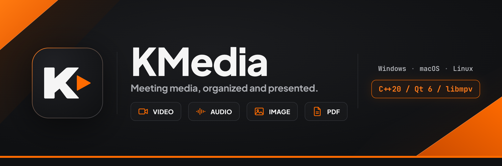
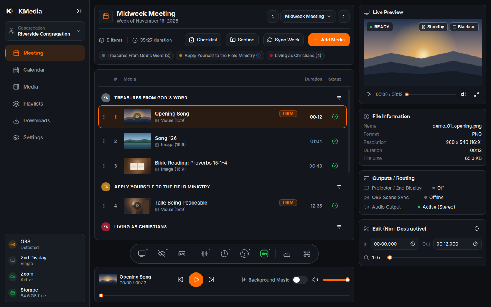
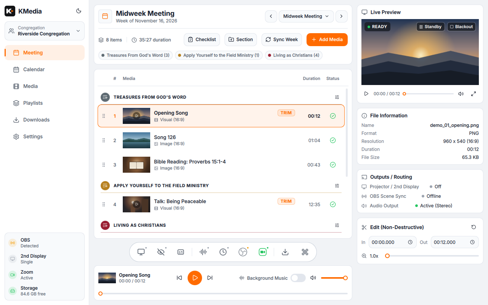
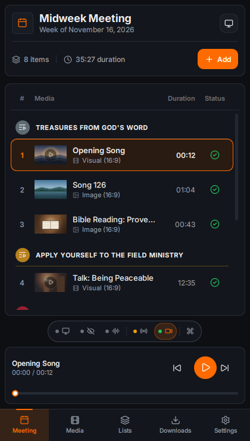

# KMedia

## Overview

**KMedia** is a free, open-source, cross-platform desktop application for Windows, macOS, and Linux that downloads, organizes, and presents audio, video, images, and PDF documents for congregation meetings.

I built KMedia from scratch in native **C++20**, **Qt 6**, and **libmpv** to deliver fast startup, low memory consumption, and quiet, reliable operation on Kingdom Hall laptops and hybrid A/V booths.

## Download and Documentation

- [Documentation website](https://matheuscardosos.github.io/kmedia/)
- [Download KMedia](https://matheuscardosos.github.io/kmedia/download)
- [Portuguese documentation](https://matheuscardosos.github.io/kmedia/pt/)

## Interface Preview

KMedia features dual **Studio Carbon (Dark)** and **Studio Daylight (Light)** booth themes, a **Meeting page** that shows each day section by section (*Treasures From God's Word*, *Apply Yourself to the Field Ministry*, *Living as Christians*, *Public Talk*, *Watchtower Study*), a **Floating Pill Action Bar**, and responsive scaling down to a compact `360x520` pane beside Zoom.

  

## Quick Overview

- **Automatic media management:** Fetch, organize, and keep weekly meeting media up to date across languages.
- **Dual-screen presentation:** Automatic secondary display detection with borderless output, standby mode, and instant blackout.
- **Native media playback:** Hardware-accelerated video and audio playback with zoom, pan, and non-destructive trim controls.
- **Hybrid meeting ready:** Native OBS Studio scene switching and one-click Zoom workflow support.
- **Multi-congregation profiles:** Keep isolated media folders, meeting schedules, and booth settings for multiple congregations in one app.
- **Cross-platform and multilingual:** Designed for Windows, macOS, and Linux with an interface translated into multiple languages.

## Why Choose KMedia?

- **Built for Kingdom Hall hardware:** Runs without heavyweight browser runtimes, keeping idle RAM usage minimal and fans quiet on older booth laptops.
- **Instant startup and switching:** Opens in fractions of a second and switches between congregation profiles immediately.
- **Hardware-accelerated stability:** Decodes video smoothly on GPU (`libmpv` with safe hardware decoding) while isolating playback reliability from the rest of the interface.
- **All media formats in one place:** Handles weekly meeting packages, public talks, PDFs, local files, and cloud-synced folders without external plugins.

## What Can KMedia Do?

- Download weekly meeting media, videos, images, and songs automatically in any available language
- Present videos, audio tracks, high-resolution images, and multi-page PDF documents on an external display
- Set non-destructive start and end trim markers, zoom/pan regions, and drag-and-drop ordering
- Add songs, JW.org videos, publication media, and public talk media from the `S-34mp` file, and import `.jwpub` publications, `.jwlplaylist` files, and local files
- Bring media from dated Dropbox, OneDrive, Google Drive, or Nextcloud folders into each day, and export each day in meeting order
- Play the songbook as background music before meetings, timed to end when the meeting starts
- Switch OBS Studio scenes (WebSocket v5) and join the congregation's Zoom meeting in one click
- Configure custom titles, schedules, and special events independently per congregation profile

## Languages and Terms of Use

Weekly meeting media can be fetched in any language available on the official website of Jehovah's Witnesses, while the KMedia interface itself supports independent UI translations.

For details regarding official website content policies, see the [Terms of Use section in the FAQ](https://matheuscardosos.github.io/kmedia/faq#does-kmedia-respect-the-terms-of-use-of-jw-org).

## Contributing and Building from Source

Interested in contributing, reporting an issue, or compiling KMedia yourself? Please check [CONTRIBUTING.md](CONTRIBUTING.md) for prerequisites, build instructions, architecture notes, and coding guidelines, or review the [CHANGELOG.md](CHANGELOG.md).

## Acknowledgements

The day by day meeting workflow of KMedia is inspired by [Meeting Media Manager](https://github.com/sircharlo/meeting-media-manager), the open source app that many congregations already use. KMedia is an independent native app written from scratch, and it is not meant to compete with it.

## License

KMedia is licensed under the [GNU Affero General Public License v3.0 (AGPL-3.0)](LICENSE).
