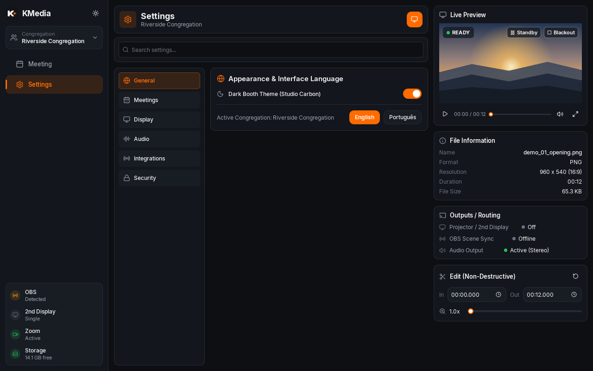

# Settings Guide

*Settings* has six categories in the order they appear on the left: General, Meetings, Display, Audio, Integrations, and Security. Each congregation profile keeps its own settings, so switching profiles also switches them.

Type in **Search settings...** to show every category that matches a word, such as `obs`, `language`, or `pin`. Case and accents do not matter.

## General

- **Dark Booth Theme (Studio Carbon):** switches between the dark and the light theme. `Ctrl+D` does the same from anywhere.
- **English** and **Português:** the interface language. It changes right away and is independent of the media language.
- The active congregation is shown here. Switch congregations from the selector at the top of the navigation.

## Meetings

### Congregation Lookup (hub.jw.org)

Search by city or congregation name and pick your congregation from the results. KMedia then sets the media language and the meeting days and times of that congregation.

### Congregation Meeting Schedule

Pick the day of the **Midweek Meeting** and of the **Weekend Meeting**, type each start time (for example `19:30`), and click **Save Times**. The meeting days decide which days KMedia prepares, and the start times are when background music finishes fading out.

Changes for one week only, such as a Circuit Overseer visit, the Memorial, or an assembly, are made on the *Meeting* page with **Special week**, not here.

### Meeting Media

- **Media language:** the language of the meeting media. Filter the list by typing, and use the refresh button to fetch the full list of languages from JW.org.
- **Fallback language:** used when an item is not available in the media language.
- **Hide media from footnotes:** leaves out pictures and videos that appear only in footnotes.
- **Include pictures meant only for the printed edition:** adds pictures that the publication shows only on paper.
- **Skip videos inside Watchtower paragraphs:** leaves out the videos linked inside the paragraphs of the *Watchtower Study*.
- **Skip videos from the Teaching brochure:** leaves out the brochure videos used in *Apply Yourself to the Field Ministry*.
- **Skip Congregation Bible Study videos:** leaves out the videos of the *Congregation Bible Study*.

Changing a language or a filter syncs the coming weeks again. Items you hid, renamed, moved, or added stay as they are.

### Media export

Turn it on and pick a folder. Every day with media is copied into a date folder (`YYYY-MM-DD`) inside it, in meeting order, with numbered names such as `01 Public Talk - 01 Picture.jpg`. KMedia updates the copy after each sync and each change, and deletes the date folders of weeks that are over.

**Convert images and audio to MP4** turns pictures and audio into videos, for players that only take video. It needs FFmpeg installed on the computer; the switch stays off until KMedia finds it.

## Display

- **Auto:** presents on the second display automatically, which is the default.
- **Presentation Output Active:** shows or hides the presentation window. `Ctrl+P` does the same.
- **Screen list:** click a screen to present on it instead. If that screen is disconnected, KMedia goes back to presenting automatically.
- **Standby picture:** the picture shown on the presentation display during standby and while nothing is presented, such as the yeartext. Without one, standby is a black screen. **Blackout** in the preview panel always shows black.

## Audio

- **Background Music & Fade Timing:** the volume of the background music, from 0 to 100%.
- **Fade-Out Duration:** 3, 5, or 8 seconds (5 by default). Background music fades out over this time when you stop it, and on its own before each meeting starts.
- **Audio output:** where media and background music play, for example the output that feeds the sound system of the hall. **System default** follows the computer's setting.

## Integrations

### OBS Studio

Turn the switch on to connect KMedia to OBS Studio, so it switches scenes for the people following the meeting on Zoom.

- **Host**, port, and **WebSocket password:** find them in OBS Studio under *Tools > WebSocket Server Settings*, where the server must be enabled. On the same computer the host is `127.0.0.1` and the port `4455`. Click **Save & Connect**; the badge shows when KMedia is connected.
- **Stage scene:** the scene shown while nothing is presented and during standby, usually the wide shot of the platform.
- **Media scene:** the scene shown while media is presented, including a paused video.
- **Image scene:** an optional scene for pictures and PDF pages, for example a picture-in-picture layout. **Same as media scene** uses the media scene.

The scenes are picked from the list OBS Studio sends once KMedia is connected. A scene left **Not set** makes KMedia leave OBS where it is. The OBS button of the pill bar still switches scenes by hand at any time.

### Zoom

- **Zoom Meeting ID**, **Passcode**, and **Name shown in Zoom:** the congregation's meeting and the name the booth joins with. Click **Save**.
- **Launch Zoom Meeting:** joins the meeting in the Zoom app. The Zoom button of the pill bar does the same.

### Shared folder

Turn it on and pick a folder that Dropbox, OneDrive, Google Drive, or Nextcloud keeps in sync between the computers of the congregation. Media inside its date folders (`YYYY-MM-DD`) shows up in that day on every computer:

- In the section it was placed in on another computer, when that computer saved its place.
- In the section named by an exported file name, such as `01 Public Talk - 01 Picture.jpg`.
- Otherwise in the day's main section: *Public Talk* on weekends, *Living as Christians* midweek, and *Circuit Overseer* in a visit week.

KMedia creates the date folders of the coming meeting days. **Delete the folders of past weeks** removes the old ones. The shared folder and the media export folder must be different folders.

## Security

### Booth Settings PIN Lock

Type a PIN of 4 to 12 letters or digits and click **Enable PIN**. From then on *Settings* opens locked and asks for the PIN, so the rest of the app stays available while the settings stay safe. **Lock** at the top of *Settings* locks it again after you are done. To remove the PIN, type the current PIN and click **Disable**.

### Keyboard Shortcuts & Diagnostics

Lists the main keyboard shortcuts and the versions of KMedia, Qt, and libmpv with the memory in use. Include this line when you report a problem.
