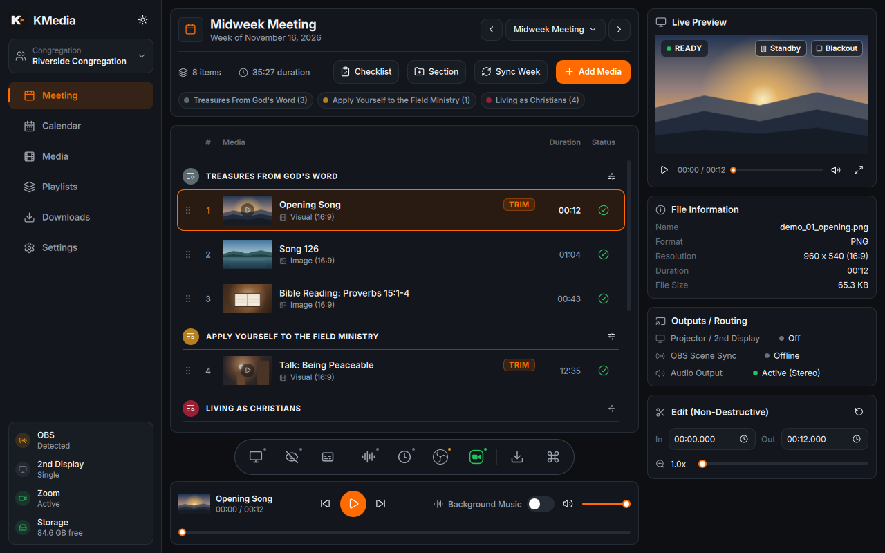
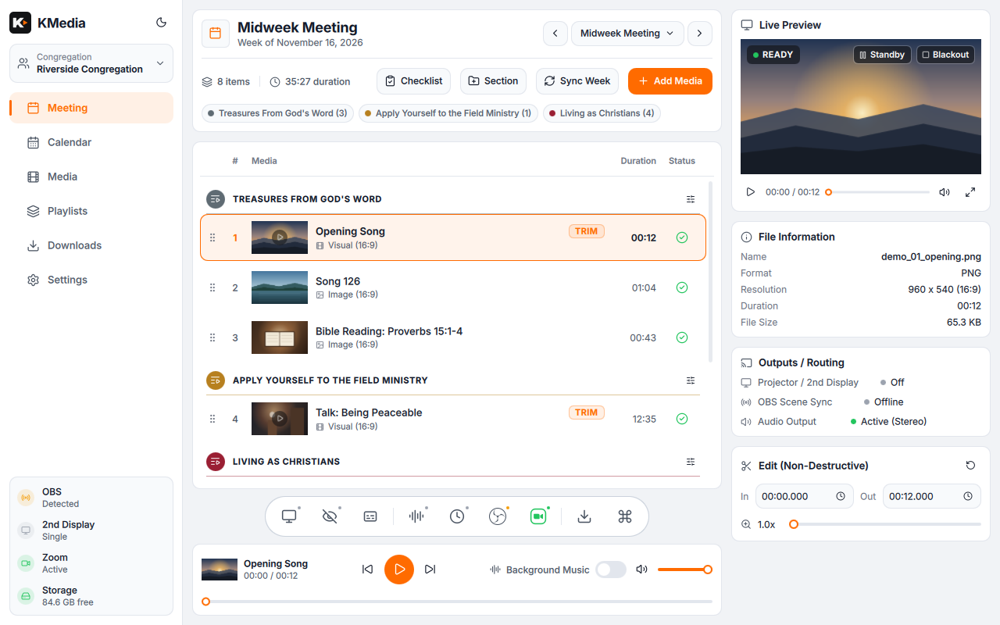
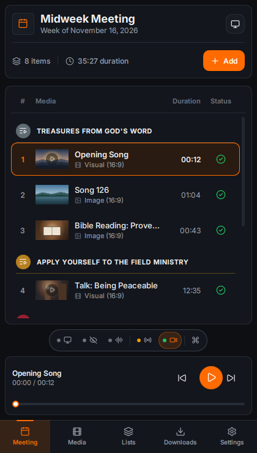
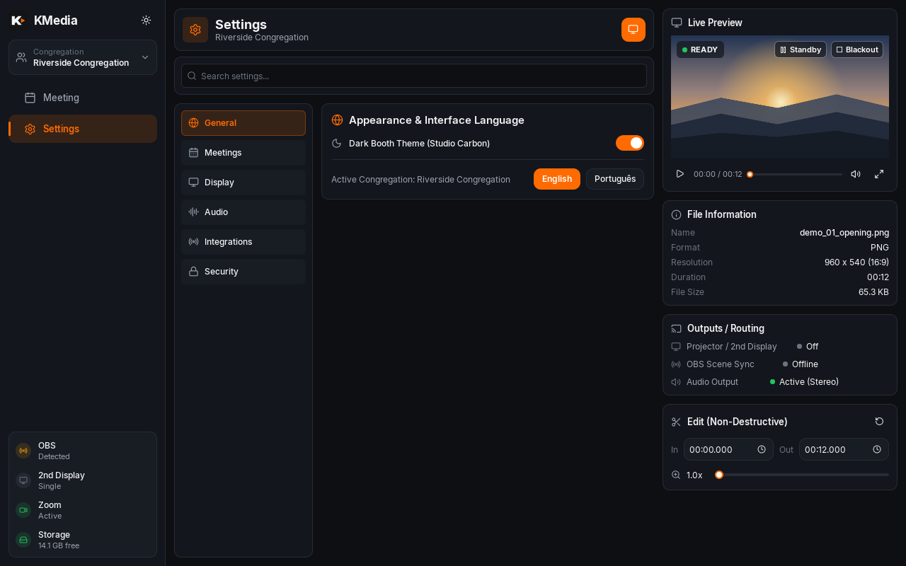

# User Guide

This guide follows a week of meetings: setting up your congregation, finding each meeting's media, adding what is missing, and presenting it.

## Getting started

### Install

Download KMedia for Windows, macOS, or Linux from the [download page](./download.md) and install it like any other app.

### First launch

1. Open **Settings > Meetings** (or click the congregation switcher at the top left and choose **Manage congregations...**) to rename your congregation or add separate congregation profiles, and search for your congregation (city or congregation name) in **Congregation Lookup** to set the media language and meeting schedule automatically.
2. Check the **Media language** and the **Fallback language**. The fallback is used when a publication or video is not available in the media language.
3. Go back to **Meeting**. KMedia starts syncing the media of the next five weeks right away, closest meeting first.

### The window at a glance

- **Navigation:** *Meeting* and *Settings*, the congregation switcher, and the status of OBS Studio, the second display, Zoom, and free disk space.
- **Meeting page:** the media of the selected day, section by section.
- **Preview panel:** what the audience sees (a playing video shows live), file details, trims, and zoom. The monitor button in the page header shows or hides it.
- **Pill bar:** quick toggles for the display, standby, subtitles, background music, the meeting timer, OBS Studio, Zoom, downloads, and the command palette.
- **Transport bar:** play, pause, previous, next, and mute for the active item, and the background music switch.

The window adapts to its width: wide windows show all three columns, medium widths fold the navigation into icons and the preview into a drawer, and narrow windows (down to 360 px, for side by side use with Zoom) move navigation to a bottom bar.

## Meeting media

### Choosing a day

The *Meeting* page opens on the next day from today that has a meeting or media. Use the arrows beside the date to jump to the previous or next day that has a meeting or media, or click the date to open the calendar. The calendar shows the days KMedia keeps ready, each with a colored dot:

| Dot | Meaning |
| --- | --- |
| Green | The meeting media is ready. |
| Orange | The day is waiting or syncing. |
| Red | Some media could not be downloaded. Open the day and click **Try again**. |
| Purple | The day has media you added. |

### How meetings sync

KMedia keeps the meetings of the next five weeks ready in the background, two days at a time and closest meeting first. For the midweek meeting it reads the meeting workbook; for the weekend meeting it finds the *Watchtower* study article of that week. Pictures, videos, and songs are placed in their sections in paragraph order, and videos show a real thumbnail.

- **Sync this day again** (page menu) syncs the open day again. Items you hid, renamed, moved, or added are kept.
- **Special week** (page menu) marks the week of the open day as a Circuit Overseer visit (the midweek meeting moves to Tuesday and the *Circuit Overseer* section is added), the Memorial, a circuit assembly, or a regional convention (no regular meetings that week). It can also give that week a temporary schedule.
- Changing the media language or a media filter in *Settings > Meetings* syncs the weeks again.

### Sections and items

Each section is a card with its colored icon and its name in the interface language. The *Watchtower Study* card shows the article title. On a meeting day the meeting's own sections always show, even while still empty; other sections show when they hold media.

Every item shows a 16:9 thumbnail with its duration, its song or paragraph number, its title, and a play button. The menu of an item holds everything else:

- **Hide from media list** and **Show in media list**. Hidden items stay out of the presentation; the section says when items are hidden, and **Show hidden media** in the page menu brings them back into view.
- **Edit tag** for the song or paragraph number, and **Rename**.
- **Slide interval** for pictures that advance on their own.
- **Speed** for videos and audio, from 0.5x to 2x, kept for that item.
- **Clip** for sign language videos made of several passages: play only one of them, or the **Whole video** again.
- **Move to section** and **Insert divider below**.
- **Delete**, for media you added. Synced media and shared folder media can only be hidden, because the next sync or the folder would bring them back.

Drag an item by its handle onto another item to move it, also across sections.

To work on several items at once, `Ctrl`+click each one, or click one and `Shift`+click another to take every visible item in between (hidden items and dividers are left out). Hiding, **Move to section**, **Delete** (or the `Delete` key), and dragging then act on the whole selection, which keeps its order. `Esc` or a plain click on an item ends the selection.

**Reset order** in the page menu restores the order of the sync. On days without a meeting you can create sections (**New section**) and rename, recolor, reorder, or delete them from their menus.

## Adding media

**Add media** in the page header adds to the section you pick (on a regular weekend, to *Public Talk*). The **+** of a section adds straight into that section.

- **Song:** type the song number; the video comes from JW.org in the media language. The *Public Talk* and *Circuit Overseer* sections show a **Song** button while they have no song yet.
- **Video:** the JW.org video library, latest videos first, searchable by title.
- **Audio Bible** (**Sign Language Bible** for sign languages): pick a book, a chapter, then the first and the last verse. The chapter recording is added trimmed to those verses, with a verse tag such as `3:16-18`. A recording without verse marks is added as the whole chapter.
- **Study Bible:** the pictures and videos of the *New World Translation* study edition. Pick a book and a chapter, then tick the media you need; each one gets a verse tag such as `4:5`. The study edition (about 120 MB) is downloaded the first time.
- **Publication media:** type a publication symbol (for example `lff`) and, for magazines and workbooks, the issue (`2026-11`), then pick the document whose media you need.
- **Public talk media:** pick your congregation's S-34mp file once, then search the talks by number or title. The talk's media goes to *Public Talk*, and the talk title becomes the section subtitle.
- **Files:** videos, audio, pictures, PDF documents, `.jwpub` publications (you then pick a document), and `.jwlplaylist` playlists from JW Library. You can also drop files on the window. A PDF with several pages first shows its pages: tick the ones you need to add them as pictures (each page then works like any picture, with zoom and a slide interval), or add the whole document as one item.

## Presenting

- Click the play button of an item, or double click the item. The active item is highlighted and shown in the preview panel.
- **Floating preview:** while the preview panel is closed (or folded into a drawer on medium widths), a small live preview of the presentation display floats in the bottom right corner whenever a picture, PDF page, or video is on it. Drag it to move it, drag a corner to resize it, and click it to see it large in the middle of the window (click again, click outside, or press any key to shrink it). It hides during standby and while the presentation display is off. Turn it off with **Floating preview** in the **Display** pill or in *Settings > Display*; the choice is kept per profile.
- **Standby** (`B`) covers the presentation display with the standby picture set in *Settings > Display*, or with this year's yeartext when there is none (the yeartext also shows while nothing is presented). **Blackout** in the preview panel always shows black and also pauses the media. Press **Standby** again to bring the media back where you left it.
- **Camera as background:** for sign language congregations, the **Display** pill lists the connected cameras. Pick one and the presentation display shows it, instead of the standby picture or the yeartext, while nothing is presented and during standby; media still plays over it. Pick **No camera** to go back. The choice is kept per profile, and a message under the list says when the camera is not connected or not allowed (on macOS, allow KMedia under *System Settings > Privacy & Security > Camera*).
- **Subtitles** (pill bar) show or hide the subtitles of a video. Videos from JW.org that have subtitles in the media language download them along with the video.
- **Trims** set a start and an end for a video or audio without changing the file. **Zoom and pan** work on pictures, videos, and PDF pages, and PDF documents can be paged. In the preview panel, hold `Ctrl` or `Shift` and turn the mouse wheel to zoom toward the pointer (up to 5x), and drag a zoomed picture to move it; the media always covers its frame, and the presentation display follows smoothly. The zoom and position are kept with the item.
- With a second display or projector connected, KMedia presents on it full screen and keeps the controls on the main screen. On a single monitor without a second screen, video plays directly inside the live preview panel and hands off seamlessly to a centered `960 x 540` presentation window whenever **Presentation Output** is toggled on. *Settings > Display* picks another screen, and *Settings > Audio* picks where the sound plays.

### Meeting timer

The clock pill opens the meeting timer, which times each part of the meeting, inspired by Meeting Media Manager.

- The parts follow the open day: the midweek meeting (song and prayer, opening comments, Treasures, spiritual gems, Bible reading, the Apply Yourself parts, song, the Living as Christians parts, Congregation Bible Study, concluding comments, song and prayer) or the weekend meeting (public talk and *Watchtower* Study), with the circuit overseer's week. A minute of counsel follows the Bible reading and each Apply Yourself part.
- Each part starts with its usual minutes; change them with **-** and **+**. Under **Options**, pick how many Apply Yourself and Living as Christians parts there are, and their 15 minutes are shared out again.
- **Start** times the next part, **Next part** ends the current one and starts the following, and a click on any part times that one. **Pause** holds the time, and the square button stops the part.
- A part that runs over turns red. **Count down** shows the time left instead of the time taken, and **Show only the extra time** shows just how much a part ran over.
- Counting down, **End the study at** makes the *Watchtower* Study or the Congregation Bible Study count down to that time (never longer than the part), so it absorbs earlier delays.
- The badge in the timer shows how many minutes the meeting is ahead or behind, from when the current part started against the meeting time in *Settings > Meetings*.
- Finished parts show how long they really took. The times are kept with the day, so they are still there after a restart; **Clear times** starts over.
- The download button saves the day's timing report as a PDF or a spreadsheet (CSV): each part with its planned and real start, its planned and real length, and the difference.
- Days without a regular meeting (an assembly, a special program) start with no parts: type a title and use **Add part**.
- **Timer window** (under **Options**) shows the timer for the chairman or the speaker: the part's title, the time in large digits, and a ring that fills as the part goes, yellow in its last minute and red once it runs over, blinking while paused or over. With a third screen it fills a screen that is neither the main nor the presentation screen; otherwise it opens as a normal window you can move. While no part runs it shows the time of day, and in the five minutes before the meeting a countdown to its start. It comes back the next time KMedia starts, and closing it turns it off.
- **Page for a tablet** (under **Options**) shows the timer on a tablet or phone at the lectern, so the speaker sees the time without it being on the congregation's screen or in Zoom. Connect the tablet to the same network as this computer and scan the QR code, or type the address shown in its browser. The page only shows the timer; every control stays in KMedia. The address carries an access code, so only devices given it can open the page; **New code** makes another one and shuts out pages opened with the old one. **Progress ring on the page** shows a ring around the time instead of the plain time. The page keeps the tablet's screen on. Change the **Port** (8787 by default) only if another program uses it. The first time, Windows may ask whether KMedia may use the network: allow it on private networks.

### Keyboard shortcuts

| Key | Action |
| --- | --- |
| `Space` | Play or pause |
| `B` | Standby |
| `Esc` | Stop |
| `Alt+Left` / `Alt+Right` | Previous or next item |
| `Delete` | Delete the active item (synced and shared folder media is hidden instead) |
| `Ctrl+M` | Start or stop background music |
| `Ctrl+P` | Show or hide the presentation display |
| `Ctrl+D` | Switch between dark and light theme |
| `Ctrl+O` | Add files |
| `Ctrl+K` | Command palette |
| `1` / `2` | *Meeting* or *Settings* |

Shortcuts without `Ctrl` or `Alt` pause while you type in a text field.

## Shared folder and media export

**Shared folder** (*Settings > Integrations*): pick a folder synced by Dropbox, OneDrive, Google Drive, or Nextcloud. Media dropped into its date folders (`YYYY-MM-DD`) shows up in that day: in the section it was placed in on another computer, in the section named by an exported file name, or in the day's main section (*Public Talk* on weekends, *Living as Christians* midweek, *Circuit Overseer* in a visit week). Moving those items in KMedia saves their place for the other computers. Folders for the coming meeting days are created for you, and the folders of past weeks can be deleted.

**Media export** (*Settings > Meetings*): every day with media is copied into a date folder of the folder you pick, in meeting order (`01 Public Talk - 01 Picture.jpg`), after each sync and each change. Images and audio can be turned into MP4 videos when FFmpeg is installed. The shared folder and the export folder must be different.

## Background music

Background music plays the songbook in the media language on its own audio player, separate from the meeting media. Start and stop it from the music button of the pill bar, the switch of the transport bar, or `Ctrl+M`.

- Before a meeting of the same day, KMedia picks songs that fill the time left and starts the first one partway, so the music ends right when the meeting starts. The songs of that meeting play last.
- At other times the whole songbook plays in a shuffled loop that favors newer songs.
- With **Start before meetings** on (*Settings > Audio*, on by default), the music starts by itself in the hour and a quarter before a meeting when KMedia is open, unless you stopped it by hand for that meeting or meeting media is playing.
- A song streams from JW.org the first time it plays and is saved for the next time, so the songbook works offline after a while.

## Zoom and OBS Studio

- **Zoom:** save the meeting ID, the passcode, and the name the booth joins with in *Settings > Integrations*, then join with **Launch Zoom Meeting** there or **Join Meeting** from the Zoom button of the pill bar.
- **OBS Studio:** turn on OBS Studio in *Settings > Integrations*, enter the WebSocket host, port (default `4455`), and password, and click **Save & Connect**. Then pick the stage scene, the media scene, and optionally an image scene: KMedia switches to the media scene while media is presented and back to the stage scene when it stops. The OBS button of the pill bar switches scenes by hand.

## Several congregations

Each congregation profile has its own settings, media, schedule, and integrations. Switch profiles from the congregation selector at the top of the navigation; the meetings of the new profile load right away.

## Troubleshooting

- **A day shows a red dot:** some media could not be downloaded. Check the internet connection, open the day, and click **Try again**.
- **Media is missing in the media language:** set a **Fallback language** in *Settings > Meetings*.
- **Sign language congregations:** songs come from the sign language songbook automatically.
- **The MP4 conversion switch is off:** install FFmpeg and restart KMedia.
- **Shared folder media does not appear:** check that the files are inside a date folder (`YYYY-MM-DD`) directly in the shared folder, and that the shared folder is not also the export folder.
- **Something else:** open an issue on [GitHub](https://github.com/matheuscardosos/kmedia/issues) with your system, KMedia version, and the steps that lead to the problem.

