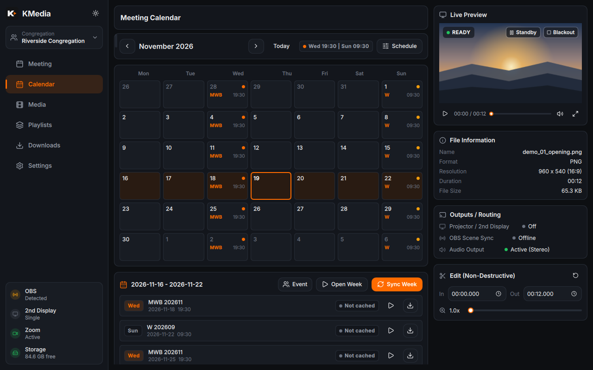
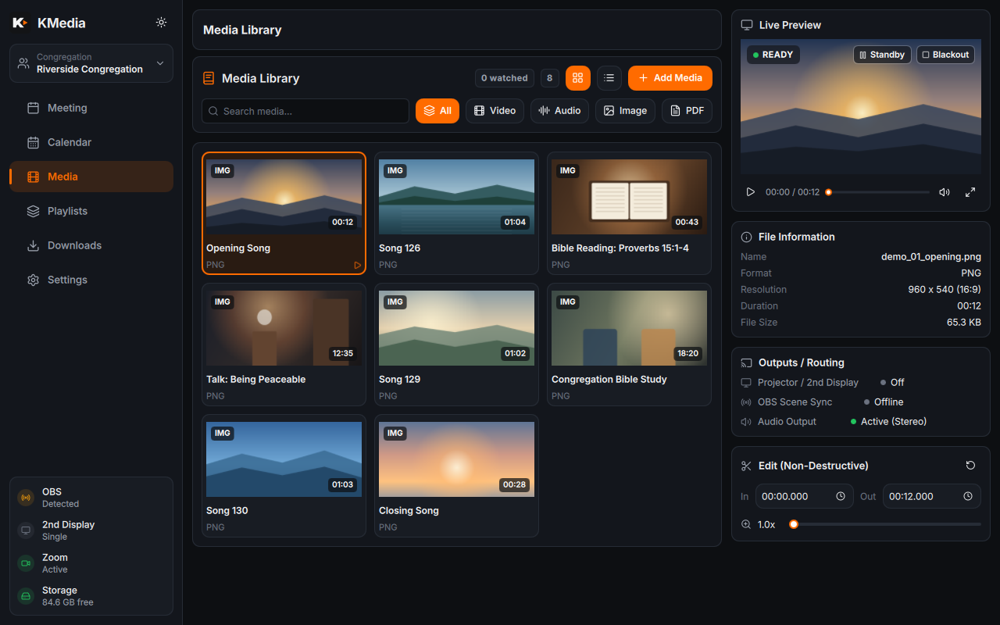

# User Guide

This guide covers the core KMedia workflow for preparing and presenting meeting media.

## Three-Column Responsive Operator Console

KMedia adapts automatically across desktop, split-screen booth laptops, and compact narrow panes (`360x520` minimum width for side-by-side Zoom use), and supports switching cleanly between **Studio Carbon (Dark)** and **Studio Daylight (Light)** themes (`Ctrl+D` or the sidebar toggle button):

1. **Wide (`>= 1080 px`):** Displays the full `234 px` left navigation rail with KMedia branding and congregation profile switcher, flexible center playlist workspace, and docked `344 px` Live Preview & Inspector card stack.
2. **Medium (`680 px` to `1079 px`):** Collapses the left rail to a narrow icon/badge bar (`64 px`) and places the Live Preview & Inspector into an on-demand slide-over drawer.
3. **Compact (`< 680 px`, down to `360x520`):** Moves navigation into a compact bottom tab bar (`54 px`), compacts the **Floating Pill Action Bar** (`ActionPillBar`) into an icon capsule, and keeps the full-width transport bar above navigation tabs.

1. **Left Navigation Rail / Compact Tabs:** Switch congregations cleanly, toggle Dark/Light theme, navigate between *Meeting*, *Calendar*, *Media*, *Playlists*, *Downloads*, and *Settings*, and inspect live OBS Studio, 2nd Display, Zoom, and free disk space.
2. **Meeting Sections, Section Glyphs, Readiness Checklists & Visual Media Library:** Items in the active meeting group automatically under colored workbook section headers (*Treasures From God's Word*, *Apply Yourself to the Field Ministry*, *Living as Christians*, *Public Talk*, *Watchtower Study*, *Circuit Overseer*, or custom sections) with dedicated monochrome vector glyphs in normal operator mode (falling back to generic list glyphs in `--demo` mode). Section names follow the interface language, custom sections keep the name you type, and removing a custom section moves its media to *Added Media*. Click **Checklist** (`BoothChecklistPopup`) for pre-meeting and post-meeting booth verification checks, **Section** (`CustomSectionPopup`) to create/rename/recolor/reorder sections, and drag items smoothly across section boundaries (`moveItem`). Switch to *Media* for a 16:9 visual thumbnail grid (or compact list mode) with live keyword search, type filter pills (*All*, *Video*, *Audio*, *Image*, *PDF*), and a compact cloud-watch indicator pill.
3. **Meeting Calendar & Special Events (`CalendarView`):** Inspect a Monday-first monthly calendar highlighting your congregation's configured midweek and weekend meeting days (`MWB` and *Watchtower* issue tags with green local-cache readiness badges), tag special event weeks (*Circuit Overseer Visit*, *Memorial*, *Circuit Assembly*, *Regional Convention*) via **Event** (`CalendarEventPopup`) to automatically inject the *Circuit Overseer* section or skip regular study sync on assembly/Memorial weeks, customize meeting days and start times (`Schedule` popup, persisted per congregation profile and applied automatically to background music fade-outs), preview the next four weeks, and click **Open Week** to jump straight into that week's meeting workspace. Meetings sync on their own: KMedia keeps the meetings of the next five weeks ready in the background (closest meeting first), each in its own day, and **Sync Week** syncs the selected day again without losing the items you hid, renamed, moved, or added.
4. **Interactive Floating Pill Bar (`ActionPillBar`):** Features enlarged icon-first booth toggles with authentic OBS Studio and Zoom emblems, instant *Standby* and *Subtitles* (`libmpv`) toggles, status LEDs, and anchored quick popovers for Monitor Selection, Background Music controls, Meeting Timer (`Elapsed` / `Remaining` / `Overtime`), Live OBS Scene Switching & Recording, Zoom Launch, Downloads concurrency, and Command Palette (`Ctrl+K`).
5. **Command Palette (`Ctrl+K`), Direct Shortcuts & Toast Feedback:** Press `Ctrl+K` anywhere or use direct operator shortcuts (`Space` play/pause, `B` standby, `Esc` stop playback, `Delete` remove active item, `Ctrl+M` toggle/fade ambient music, `Alt+Left`/`Alt+Right` previous/next item, `Ctrl+P` toggle stage display, `Ctrl+D` switch theme, `Ctrl+O` add media, and `1`-`6` switch workspace tabs when not editing text).
6. **Right Live Preview & Inspector Cards:** Monitor the 16:9 stage output with *ON AIR / READY / STANDBY* overlays, instant *Standby* / *Blackout* glass buttons, real file metadata, live routing status, non-destructive trim markers (`00:00.000`), and viewport zoom or PDF page controls.
7. **Searchable Two-Pane Settings & Booth PIN Lock:** Organize configuration cleanly across six searchable categories (*General*, *Schedule*, *Display*, *Audio*, *Integrations*, *Security*) with optional salted SHA-256 Booth PIN protection (`BoothSecurity` / `SettingsPinGate`) to prevent accidental changes on shared auditorium laptops, plus `--tab <meeting|calendar|media|playlists|downloads|settings>` launch targeting.

## Playback, Trim, Zoom, and PDF Presentation

- **Non-Destructive Video and Audio Trims:** Start (`trimStartMs`) and end (`trimEndMs`) markers are enforced directly by `libmpv` without modifying or re-encoding original files. Setting an end time earlier than or equal to the start time disables the upper bound cleanly.
- **Image and Video Viewport Controls:** Adjust zoom (`1.0x` to `8.0x`) and pan coordinates (`-0.5` to `+0.5`) smoothly across video, image, and PDF presentation output, or reset the viewport with one click.
- **Multi-Page PDF Documents:** Navigate pages (`Previous`, `Next`, or direct page selection) rendered natively through `Qt6::Pdf` at display resolution.

## Background Music and Meeting Schedules

- Background ambient music runs on a dedicated audio-only `libmpv` pipeline independent from presentation video playback.
- Configure midweek and weekend meeting start times so background music initiates an automatic smooth fade-out (default `5000 ms`) scheduled to finish right when the meeting starts. Manual pause or play overrides remain active for that session.

## Importing Media

- **Drag and Drop:** Drop video (`MP4`, `MKV`, `WebM`), audio (`MP3`, `AAC`, `OGG`, `FLAC`), image (`JPEG`, `PNG`, `WebP`), or `PDF` files directly onto the playlist.
- **Publication and Public Talk Packages (`.jwpub` and `S-34 / S-34mp`):** Open `.jwpub` archives natively with `minizip-ng` (including nested `contents` SQLite inspection and Zip-Slip path checks) and selectively extract only the requested meeting images, videos, or public talk media assets without cluttering disk storage.
- **JW Library Playlists (`.jwlplaylist`):** Import `.jwlplaylist` archives preserving `TagMap` item order, marker labels, loop flags (`EndAction`), embedded media/thumbnails, and non-destructive trim bounds converted cleanly from 100-nanosecond ticks.
- **Weekly Meeting Auto-Sync, Week Filters & Publication Catalog:** Switch seamlessly between date-keyed meeting days (**Midweek**, **Weekend**, **Circuit Overseer Visit**, **Memorial**, and custom non-meeting days) directly from the Meeting Workspace header strip or Calendar. KMedia resolves exact workbook dates via `.jwpub` `DatedText` and probes candidate Watchtower study articles (`6`, `8`, `10`, `12` weeks back), parses `Question` paragraph labels and `DocumentExtract` song/reference groups, resolves external videos and songs via JW Mediator (`v1/media-items`) with `GETPUBMEDIALINKS` and secondary language fallback, treats long files over `35` minutes (`2100 s`) as stream-only items, and provides Congregation Lookup (`hub.jw.org`) plus configurable extraction filters (footnotes, printed artwork, WT paragraph videos, `th`, CBS sources).
- **Meeting Organization Controls:** Group multi-item extracts inside collapsible groups, insert colored dividers, assign or click inline tags (`Song X`, `Para. Y`, `*`), toggle hidden items (`Hidden` filter toggle), adjust section repeat and slide intervals, reset original synced ordering, and filter playlist rows live (`Ctrl+F`).
- **Watched Cloud Folders:** Configure local Dropbox, OneDrive, Google Drive, or Nextcloud folders (or auto-detect standard sync folders) so newly added and settled items appear automatically with `500 ms` stability debouncing.

## Presenting on a Secondary Display

When a secondary monitor or projector is connected, KMedia automatically targets it for full-screen borderless presentation (`"KMedia - Presentation"`) while keeping the operator console on the primary screen. Use the *Standby / Blackout* control to switch smoothly between active media and a black screen or custom congregation standby image without losing playlist state.
