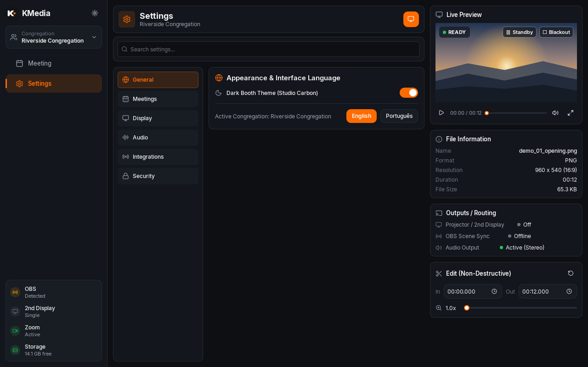

# Guia de Configurações

As *Configurações* têm seis categorias, na ordem em que aparecem à esquerda: Geral, Reuniões, Tela, Áudio, Integrações e Segurança. Cada perfil de congregação guarda suas próprias configurações, então trocar de perfil também troca as configurações.

Digite em **Buscar configurações...** para mostrar todas as categorias que combinam com uma palavra, como `obs`, `zoom` ou `pin`.

## Geral

- **Tema Escuro da Cabine (Studio Carbon):** alterna entre o tema escuro e o claro. `Ctrl+D` faz o mesmo de qualquer lugar.
- **English** e **Português:** o idioma da interface. Muda na hora e não depende do idioma das mídias.
- A congregação ativa aparece aqui. Troque de congregação pelo seletor no topo da navegação.

## Reuniões

### Busca de Congregação (hub.jw.org)

Procure pela cidade ou pelo nome da congregação e escolha a sua nos resultados. O KMedia então define o idioma das mídias e os dias e horários das reuniões dessa congregação.

### Horários das Reuniões da Congregação

Escolha o dia da **Reunião de Meio de Semana** e da **Reunião de Fim de Semana**, digite o horário de início de cada uma (por exemplo `19:30`) e clique em **Salvar Horários**. Os dias das reuniões decidem quais dias o KMedia prepara, e os horários de início marcam quando a música ambiente termina de diminuir.

Mudanças de uma semana só, como a visita do superintendente de circuito, a Celebração ou uma assembleia, são feitas na página *Reunião* com **Semana especial**, e não aqui.

### Mídias da Reunião

- **Idioma das mídias:** o idioma das mídias da reunião. Digite para filtrar a lista e use o botão de atualizar para buscar a lista completa de idiomas do JW.org.
- **Idioma de reserva:** usado quando um item não existe no idioma das mídias.
- **Ocultar mídias das notas de rodapé:** deixa de fora imagens e vídeos que aparecem só nas notas de rodapé.
- **Incluir imagens feitas só para a edição impressa:** adiciona imagens que a publicação mostra só no papel.
- **Ignorar vídeos dentro dos parágrafos de A Sentinela:** deixa de fora os vídeos ligados dentro dos parágrafos do *Estudo de A Sentinela*.
- **Ignorar vídeos da brochura Melhore:** deixa de fora os vídeos da brochura usados em *Faça Seu Melhor no Ministério*.
- **Ignorar vídeos do Estudo Bíblico de Congregação:** deixa de fora os vídeos do *Estudo Bíblico de Congregação*.

Mudar um idioma ou um filtro sincroniza de novo as próximas semanas. O que você ocultou, renomeou, moveu ou adicionou continua como está.

### Exportação de mídias

Ative e escolha uma pasta. Cada dia com mídias é copiado para uma pasta com a data (`AAAA-MM-DD`) dentro dela, na ordem da reunião e com nomes numerados como `01 Discurso Público - 01 Imagem.jpg`. O KMedia atualiza a cópia depois de cada sincronização e de cada mudança, e exclui as pastas com data das semanas que já terminaram.

**Converter imagens e áudios em MP4** transforma imagens e áudios em vídeos, para reprodutores que só aceitam vídeo. Precisa do FFmpeg instalado no computador; a chave fica desligada até o KMedia encontrá-lo.

## Tela

- **Auto:** apresenta na segunda tela automaticamente, que é o padrão.
- **Saída de Apresentação Ativa:** mostra ou esconde a janela de apresentação. `Ctrl+P` faz o mesmo.
- **Lista de telas:** clique numa tela para apresentar nela. Se essa tela for desconectada, o KMedia volta a apresentar automaticamente.

## Áudio

- **Música Ambiente e Tempo de Fade:** o volume da música ambiente, de 0 a 100%.
- **Duração do Fade-Out:** 3, 5 ou 8 segundos (5 por padrão). A música ambiente vai diminuindo durante esse tempo quando você a para, e sozinha antes de cada reunião começar.

## Integrações

### OBS Studio e Zoom

- **Host OBS** e porta: o endereço do servidor WebSocket do OBS Studio, `127.0.0.1` e `4455` quando o OBS roda no mesmo computador. No OBS Studio, ative o servidor em *Ferramentas > Configurações do servidor WebSocket*.
- **ID da Reunião Zoom:** o ID da reunião Zoom da congregação.
- **Salvar e Conectar:** salva os dois e conecta ao OBS Studio. O estado do OBS e do Zoom aparece embaixo, na navegação.
- **Abrir Reunião Zoom:** abre a reunião no aplicativo do Zoom.

### Pasta compartilhada

Ative e escolha uma pasta que o Dropbox, OneDrive, Google Drive ou Nextcloud mantém sincronizada entre os computadores da congregação. As mídias dentro das pastas com data (`AAAA-MM-DD`) aparecem naquele dia em todos os computadores:

- Na seção em que foram colocadas em outro computador, quando esse computador guardou a posição.
- Na seção indicada por um nome de arquivo exportado, como `01 Discurso Público - 01 Imagem.jpg`.
- Senão, na seção principal do dia: *Discurso Público* no fim de semana, *Nossa Vida Cristã* no meio de semana e *Superintendente de Circuito* na semana da visita.

O KMedia cria as pastas com data dos próximos dias de reunião. **Excluir as pastas de semanas passadas** remove as antigas. A pasta compartilhada e a pasta de exportação precisam ser diferentes.

## Segurança

### Bloqueio por PIN da Cabine

Digite um PIN de 4 a 12 letras ou números e clique em **Ativar PIN**. A partir daí as *Configurações* abrem bloqueadas e pedem o PIN, então o resto do aplicativo continua disponível enquanto as configurações ficam protegidas. **Bloquear**, no topo das *Configurações*, bloqueia de novo quando você terminar. Para remover o PIN, digite o PIN atual e clique em **Desativar**.

### Atalhos de Teclado e Diagnósticos

Lista os principais atalhos de teclado e as versões do KMedia, do Qt e do libmpv, com a memória em uso. Inclua essa linha quando relatar um problema.
