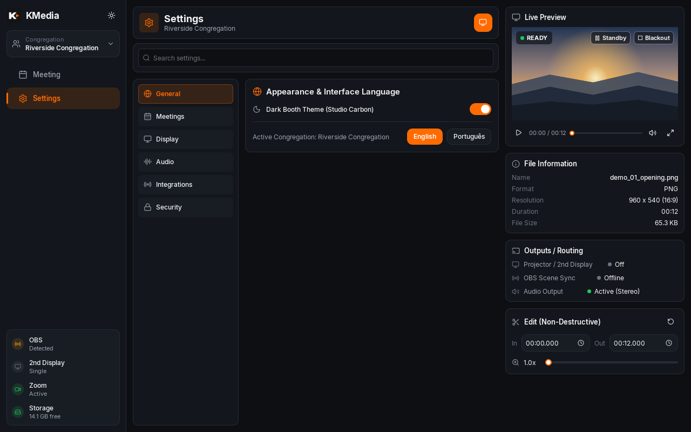

# Guia do Usuário

Este guia acompanha uma semana de reuniões: configurar sua congregação, encontrar as mídias de cada reunião, adicionar o que falta e apresentar.

## Primeiros passos

### Instalação

Baixe o KMedia para Windows, macOS ou Linux na [página de download](./download.md) e instale como qualquer outro aplicativo.

### Primeira abertura

1. Abra **Configurações > Reuniões** e procure sua congregação (cidade ou nome da congregação). Escolhê-la na lista define o idioma das mídias e os dias e horários das reuniões.
2. Confira o **Idioma das mídias** e o **Idioma de reserva**. O idioma de reserva é usado quando uma publicação ou um vídeo não existe no idioma das mídias.
3. Volte para **Reunião**. O KMedia começa na hora a sincronizar as mídias das próximas cinco semanas, a reunião mais próxima primeiro.

### A janela em resumo

- **Navegação:** *Reunião* e *Configurações*, a troca de congregação e o estado do OBS Studio, da segunda tela, do Zoom e do espaço livre em disco.
- **Página Reunião:** as mídias do dia escolhido, seção por seção.
- **Painel de prévia:** o que o público vê (um vídeo tocando aparece ao vivo), detalhes do arquivo, cortes e zoom. O botão de monitor no cabeçalho da página mostra ou esconde o painel.
- **Barra em pílula:** atalhos para a tela de apresentação, espera, legendas, música ambiente, cronômetro da reunião, OBS Studio, Zoom, downloads e paleta de comandos.
- **Barra de reprodução:** reproduzir, pausar, anterior, próximo e silenciar o item ativo, e a chave da música ambiente.

A janela se adapta à largura: janelas largas mostram as três colunas, larguras médias reduzem a navegação a ícones e a prévia a uma gaveta, e janelas estreitas (até 360 px, para usar lado a lado com o Zoom) levam a navegação para uma barra embaixo.

## Mídias da reunião

### Escolher o dia

A página *Reunião* abre no próximo dia, de hoje em diante, que tem reunião ou mídia. Use as setas ao lado da data para ir ao dia anterior ou ao próximo com reunião ou mídia, ou clique na data para abrir o calendário. O calendário mostra os dias que o KMedia deixa prontos, cada um com um ponto colorido:

| Ponto | Significado |
| --- | --- |
| Verde | As mídias da reunião estão prontas. |
| Laranja | O dia está esperando ou sincronizando. |
| Vermelho | Algumas mídias não puderam ser baixadas. Abra o dia e clique em **Tentar de novo**. |
| Roxo | O dia tem mídias que você adicionou. |

### Como as reuniões sincronizam

O KMedia deixa prontas em segundo plano as reuniões das próximas cinco semanas, dois dias por vez e a reunião mais próxima primeiro. Para a reunião de meio de semana ele lê a apostila; para a de fim de semana ele encontra o artigo de estudo de *A Sentinela* daquela semana. Imagens, vídeos e cânticos ficam nas suas seções na ordem dos parágrafos, e os vídeos mostram uma miniatura de verdade.

- **Sincronizar este dia de novo** (menu da página) sincroniza de novo o dia aberto. O que você ocultou, renomeou, moveu ou adicionou continua como está.
- **Semana especial** (menu da página) marca a semana do dia aberto como visita do superintendente de circuito (a reunião de meio de semana passa para terça e a seção *Superintendente de Circuito* é adicionada), Celebração, assembleia de circuito ou congresso regional (sem reuniões normais nessa semana). Também pode dar a essa semana um horário temporário.
- Mudar o idioma das mídias ou um filtro de mídias em *Configurações > Reuniões* sincroniza as semanas de novo.

### Seções e itens

Cada seção é um cartão com ícone colorido e nome no idioma da interface. O cartão do *Estudo de A Sentinela* mostra o título do artigo. Em dia de reunião, as seções da própria reunião sempre aparecem, mesmo vazias; as outras seções aparecem quando têm mídia.

Cada item mostra uma miniatura 16:9 com a duração, o número do cântico ou do parágrafo, o título e um botão de reprodução. O menu do item tem todo o resto:

- **Ocultar da lista de mídias** e **Mostrar na lista de mídias**. Itens ocultos ficam fora da apresentação; a seção avisa quando há itens ocultos, e **Mostrar mídias ocultas**, no menu da página, volta a mostrá-los.
- **Editar etiqueta** para o número do cântico ou do parágrafo, e **Renomear**.
- **Intervalo do slide** para imagens que avançam sozinhas.
- **Velocidade** para vídeos e áudios, de 0,5x a 2x, guardada para aquele item.
- **Trecho** para vídeos em língua de sinais feitos de várias passagens: toque só uma delas, ou o **Vídeo inteiro** de novo.
- **Mover para seção** e **Inserir divisor abaixo**.
- **Excluir**, para mídias que você adicionou. Mídias sincronizadas e da pasta compartilhada só podem ser ocultadas, porque a próxima sincronização ou a pasta as trariam de volta.

Arraste um item pela alça até outro item para movê-lo, inclusive entre seções.

Para trabalhar com vários itens de uma vez, use `Ctrl`+clique em cada um, ou clique em um e `Shift`+clique em outro para pegar todos os itens visíveis entre eles (itens ocultos e divisores ficam de fora). Ocultar, **Mover para seção**, **Excluir** (ou a tecla `Delete`) e arrastar passam a agir sobre a seleção inteira, que mantém a ordem. `Esc` ou um clique simples num item encerra a seleção.

**Redefinir ordem**, no menu da página, volta à ordem da sincronização. Em dias sem reunião você pode criar seções (**Nova seção**) e renomear, colorir, reordenar ou excluir seções pelos menus delas.

## Adicionar mídias

**Adicionar mídia**, no cabeçalho da página, adiciona na seção que você escolher (num fim de semana comum, no *Discurso Público*). O **+** de uma seção adiciona direto nela.

- **Cântico:** digite o número do cântico; o vídeo vem do jw.org no idioma das mídias. As seções *Discurso Público* e *Superintendente de Circuito* mostram um botão **Cântico** enquanto ainda não têm cântico.
- **Vídeo:** a videoteca do jw.org, os vídeos mais recentes primeiro, com pesquisa pelo título.
- **Bíblia em áudio** (**Bíblia em língua de sinais** para línguas de sinais): escolha um livro, um capítulo e depois o primeiro e o último versículo. A gravação do capítulo é adicionada cortada nesses versículos, com uma etiqueta como `3:16-18`. Uma gravação que não marca os versículos é adicionada com o capítulo inteiro.
- **Bíblia de Estudo:** as imagens e os vídeos da edição de estudo da *Tradução do Novo Mundo*. Escolha um livro e um capítulo e marque as mídias que precisa; cada uma recebe uma etiqueta de versículo como `4:5`. A edição de estudo (cerca de 120 MB) é baixada na primeira vez.
- **Mídias de publicação:** digite a sigla da publicação (por exemplo `lff`) e, para revistas e apostilas, a edição (`2026-11`); depois escolha o documento cujas mídias você precisa.
- **Mídias do discurso público:** escolha uma vez o arquivo S-34mp da sua congregação e depois procure os discursos por número ou tema. As mídias do discurso vão para o *Discurso Público*, e o tema vira o subtítulo da seção.
- **Arquivos:** vídeos, áudios, imagens, documentos PDF, publicações `.jwpub` (depois você escolhe um documento) e listas `.jwlplaylist` do JW Library. Também dá para arrastar arquivos para a janela. Um PDF com várias páginas mostra as páginas antes: marque as que precisa para adicioná-las como imagens (cada página passa a funcionar como qualquer imagem, com zoom e intervalo do slide) ou adicione o documento inteiro como um item só.

## Apresentar

- Clique no botão de reprodução de um item ou dê um duplo clique nele. O item ativo fica destacado e aparece no painel de prévia.
- **Prévia flutuante:** com o painel de prévia fechado (ou recolhido em gaveta nas larguras médias), uma pequena prévia ao vivo da tela de apresentação flutua no canto inferior direito sempre que uma imagem, página de PDF ou vídeo está nela. Arraste para mover, arraste um canto para redimensionar e clique para ver grande no meio da janela (clique de novo, clique fora ou aperte qualquer tecla para diminuir). Ela some durante a espera e com a tela de apresentação desligada. Desligue em **Prévia flutuante** na pílula **Tela** ou em *Configurações > Tela*; a escolha fica salva por perfil.
- **Espera** (`B`) cobre a tela de apresentação com a imagem de espera definida em *Configurações > Tela*, ou com o texto do ano quando não há uma (o texto do ano também aparece enquanto nada é apresentado). **Blackout**, no painel de prévia, sempre mostra preto e também pausa a mídia. Clique em **Espera** de novo para voltar à mídia de onde parou.
- **Câmera como fundo:** para congregações de língua de sinais, a pílula **Tela** lista as câmeras conectadas. Escolha uma e a tela de apresentação passa a mostrá-la, no lugar da imagem de espera ou do texto do ano, enquanto nada é apresentado e durante a espera; a mídia continua tocando por cima. Escolha **Nenhuma câmera** para voltar. A escolha fica salva por perfil, e uma mensagem abaixo da lista avisa quando a câmera não está conectada ou não tem permissão (no macOS, permita o KMedia em *Ajustes do Sistema > Privacidade e Segurança > Câmera*).
- **Legendas** (barra em pílula) mostram ou escondem as legendas de um vídeo. Os vídeos do JW.org que têm legendas no idioma das mídias baixam as legendas junto com o vídeo.
- **Cortes** definem início e fim de um vídeo ou áudio sem mudar o arquivo. **Zoom e posição** funcionam em imagens, vídeos e páginas de PDF, e documentos PDF podem ser folheados.
- Com uma segunda tela ou projetor conectado, o KMedia apresenta nela em tela cheia e deixa os controles na tela principal. *Configurações > Tela* escolhe outra tela, e *Configurações > Áudio* escolhe onde o som toca.

### Atalhos de teclado

| Tecla | Ação |
| --- | --- |
| `Espaço` | Reproduzir ou pausar |
| `B` | Espera |
| `Esc` | Parar |
| `Alt+Esquerda` / `Alt+Direita` | Item anterior ou próximo |
| `Delete` | Excluir o item ativo (mídia sincronizada ou da pasta compartilhada é ocultada) |
| `Ctrl+M` | Tocar ou parar a música ambiente |
| `Ctrl+P` | Mostrar ou esconder a tela de apresentação |
| `Ctrl+D` | Alternar tema escuro e claro |
| `Ctrl+O` | Adicionar arquivos |
| `Ctrl+K` | Paleta de comandos |
| `1` / `2` | *Reunião* ou *Configurações* |

Atalhos sem `Ctrl` ou `Alt` ficam pausados enquanto você digita num campo de texto.

## Pasta compartilhada e exportação de mídias

**Pasta compartilhada** (*Configurações > Integrações*): escolha uma pasta sincronizada pelo Dropbox, OneDrive, Google Drive ou Nextcloud. As mídias colocadas nas pastas com data (`AAAA-MM-DD`) aparecem naquele dia: na seção em que foram colocadas em outro computador, na seção indicada por um nome de arquivo exportado ou na seção principal do dia (*Discurso Público* no fim de semana, *Nossa Vida Cristã* no meio de semana, *Superintendente de Circuito* na semana da visita). Mover esses itens no KMedia guarda a posição para os outros computadores. As pastas dos próximos dias de reunião são criadas para você, e as pastas de semanas passadas podem ser excluídas.

**Exportação de mídias** (*Configurações > Reuniões*): cada dia com mídias é copiado para uma pasta com a data dentro da pasta escolhida, na ordem da reunião (`01 Discurso Público - 01 Imagem.jpg`), depois de cada sincronização e de cada mudança. Imagens e áudios podem virar vídeos MP4 quando o FFmpeg está instalado. A pasta compartilhada e a pasta de exportação precisam ser diferentes.

## Música ambiente

A música ambiente toca o cancioneiro no idioma das mídias num reprodutor de áudio próprio, separado das mídias da reunião. Toque e pare pelo botão de música da barra em pílula, pela chave da barra de reprodução ou com `Ctrl+M`.

- Antes de uma reunião do mesmo dia, o KMedia escolhe cânticos que preenchem o tempo que falta e começa o primeiro do meio, para a música terminar bem na hora em que a reunião começa. Os cânticos dessa reunião tocam por último.
- Nos outros momentos, o cancioneiro inteiro toca em ordem aleatória e repetida, com preferência pelos cânticos mais novos.
- Com **Começar antes das reuniões** ativado (*Configurações > Áudio*, ativado por padrão), a música começa sozinha na hora e quinze minutos antes de uma reunião quando o KMedia está aberto, a não ser que você a tenha parado na mão para essa reunião ou que uma mídia da reunião esteja tocando.
- Um cântico toca direto do JW.org na primeira vez e fica salvo para as próximas, então o cancioneiro passa a funcionar sem internet com o tempo.

## Zoom e OBS Studio

- **Zoom:** salve o ID da reunião, a senha e o nome com que a cabine entra em *Configurações > Integrações*, e entre com **Abrir Reunião Zoom** ali mesmo ou com **Entrar na Reunião** no botão do Zoom da barra em pílula.
- **OBS Studio:** ative o OBS Studio em *Configurações > Integrações*, informe o host, a porta (padrão `4455`) e a senha do WebSocket e clique em **Salvar e Conectar**. Depois escolha a cena de palco, a cena de mídia e, se quiser, uma cena de imagens: o KMedia troca para a cena de mídia enquanto uma mídia é apresentada e volta para a cena de palco quando ela para. O botão do OBS na barra em pílula troca as cenas na mão.

## Várias congregações

Cada perfil de congregação tem suas próprias configurações, mídias, agenda e integrações. Troque de perfil no seletor de congregação no topo da navegação; as reuniões do novo perfil carregam na hora.

## Solução de problemas

- **Um dia mostra ponto vermelho:** algumas mídias não puderam ser baixadas. Confira a internet, abra o dia e clique em **Tentar de novo**.
- **Falta mídia no idioma das mídias:** defina um **Idioma de reserva** em *Configurações > Reuniões*.
- **Congregações de língua de sinais:** os cânticos vêm do cancioneiro em língua de sinais automaticamente.
- **A conversão para MP4 está desligada:** instale o FFmpeg e reabra o KMedia.
- **As mídias da pasta compartilhada não aparecem:** confira se os arquivos estão dentro de uma pasta com data (`AAAA-MM-DD`) direto na pasta compartilhada, e se a pasta compartilhada não é também a pasta de exportação.
- **Outra coisa:** abra uma issue no [GitHub](https://github.com/matheuscardosos/kmedia/issues) com seu sistema, a versão do KMedia e os passos que levam ao problema.

