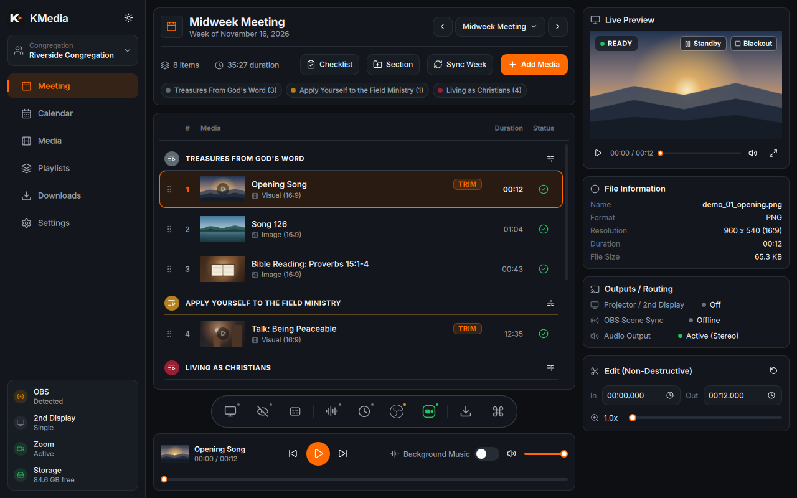
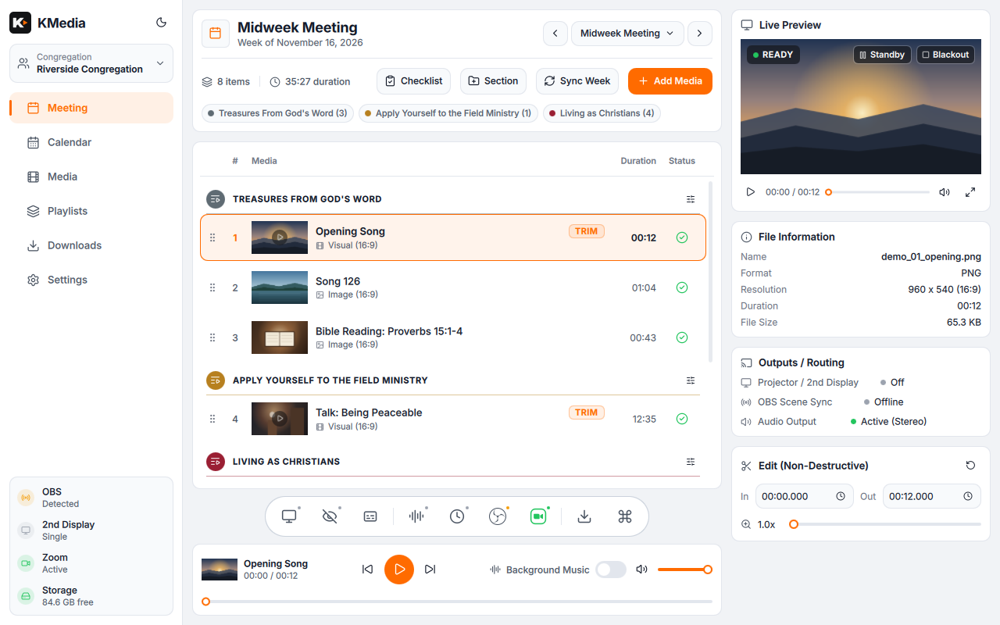
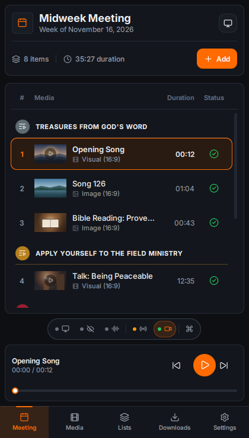

# Manual do Usuário

Este manual apresenta o fluxo principal do KMedia para preparar e exibir mídias das reuniões.

## Console Responsivo de Três Colunas

O KMedia se adapta automaticamente a telas largas de cabine, divisão 50/50 ou janela compacta lateral (`360x520` mínimo para trabalhar lado a lado com o Zoom) e permite alternar entre os temas **Studio Carbon (Escuro)** e **Studio Daylight (Claro)** via `Ctrl+D` ou pelo botão no topo da barra lateral:

1. **Barra Lateral / Abas Compactas:** Troque de congregação, alterne entre tema escuro e claro, navegue entre as duas páginas, *Meeting* e *Settings*, cada uma com o mesmo cabeçalho (ícone, título e congregação), e acompanhe OBS Studio, segunda tela, Zoom e espaço livre em disco. A página *Settings* só é criada na primeira vez que você a abre.
2. **Modo Médio (`680 px` a `1079 px`):** Recolhe a barra lateral para o modo compacto (`64 px`) e transforma a pré-visualização ao vivo em gaveta retrátil sob demanda.
3. **Modo Compacto (`< 680 px`, até `360x520`):** Move a navegação para abas inferiores compactas (`54 px`), resume a **Barra em Pílula (`ActionPillBar`)** a ícones com indicadores de status e mantém a barra de reprodução e acesso ao *Standby*.

1. **Barra Lateral / Abas Compactas:** Alterne perfis de congregação e o tema Claro/Escuro, navegue entre *Reunião*, *Calendário*, *Mídias*, *Playlists*, *Downloads* e *Configurações*, e acompanhe em tempo real o status de OBS, 2ª Tela, Zoom e armazenamento livre em disco.
2. **Página de Mídias da Reunião (`MeetingMediaPage`):** A página *Meeting* abre no primeiro dia, de hoje em diante, que tem reunião ou mídia. O cabeçalho mostra a reunião (ou a data nos outros dias) e a congregação, botões de anterior e próximo que pulam para o dia mais próximo com reunião ou mídia, e um botão de data cujo calendário marca cada dia da janela de sincronização: verde quando está pronto, laranja enquanto sincroniza, vermelho quando algo falhou e roxo quando o dia tem mídia que você adicionou. Cada seção é um cartão com ícone colorido, nome no idioma da interface e, no *Estudo de A Sentinela*, o título do artigo. As seções da reunião sempre aparecem nos dias de reunião e as outras só quando têm mídia; nos outros dias você pode criar, renomear, colorir, reordenar e excluir seções pelos menus delas. Cada item mostra uma miniatura 16:9 com a duração (a própria imagem, a capa que o JW.org publica para os vídeos dele ou um quadro dos seus próprios vídeos), a etiqueta de cântico ou parágrafo e um botão de reprodução; ocultar, etiquetas, renomear, intervalo de slide, mover, divisores e excluir ficam no menu do item. Mídias sincronizadas podem ser ocultadas, mas não excluídas, porque a próxima sincronização as traria de volta. **Adicionar mídia** adiciona um cântico pelo número do jw.org ou arquivos do seu computador na seção que você escolher (o *Discurso Público* num fim de semana comum), e o botão **Cântico** das seções *Discurso Público* e *Superintendente de Circuito* adiciona o cântico delas enquanto ainda não têm um. Arraste um item pela alça até outro item para movê-lo, inclusive entre seções. O menu da página também tem **Semana especial**, **Sincronizar este dia de novo**, mídias ocultas, **Redefinir ordem**, divisores e o **Checklist** (`BoothChecklistPopup`).
3. **Reuniões, Semanas Especiais e Sincronização:** Em *Settings > Meetings* você encontra sua congregação no hub.jw.org, define os dias e horários das reuniões (usados também para encerrar a música ambiente), o idioma das mídias e o de reserva, e os filtros de mídia (notas de rodapé, imagens só da edição impressa, vídeos nos parágrafos de *A Sentinela*, vídeos da brochura *Melhore*, vídeos do Estudo Bíblico de Congregação). **Semana especial**, no menu da página *Meeting*, marca a semana do dia aberto como visita do superintendente de circuito (adiciona a seção *Superintendente de Circuito* e passa a reunião de meio de semana para terça), Celebração, assembleia de circuito ou congresso regional (sem reuniões normais nessa semana), ou dá a essa semana um horário temporário. As reuniões sincronizam sozinhas: o KMedia deixa prontas em segundo plano as reuniões das próximas cinco semanas (a mais próxima primeiro), cada uma no seu dia, e **Sincronizar este dia de novo** sincroniza o dia aberto sem perder o que você ocultou, renomeou, moveu ou adicionou.
4. **Barra Flutuante em Pílula (`ActionPillBar`):** Conta com botões ampliados guiados por ícones (incluindo os emblemas de OBS Studio e Zoom nas cores do sistema), indicadores de status em LED, alternância imediata de *Espera / Blackout* e *Legendas* (`libmpv`), além de popovers ancorados para escolher o monitor de exibição, controlar música ambiente, acompanhar o cronômetro da reunião (`Decorrido` / `Restante` / `Excedido`), trocar cenas do OBS ao vivo, abrir o Zoom e acompanhar a fila de downloads (cada transferência com progresso, pausar, retomar, repetir e cancelar, além da quantidade simultânea).
5. **Paleta de Comandos (`Ctrl+K`), Atalhos Diretos e Notificações:** Pressione `Ctrl+K` em qualquer tela ou use os atalhos diretos da cabine (`Espaço` reproduzir/pausar, `B` modo espera/standby, `Esc` parar exibição, `Del` remover o item ativo (mídia sincronizada é ocultada), `Ctrl+M` iniciar/reduzir música ambiente, `Alt+Esquerda`/`Alt+Direita` item anterior/próximo, `Ctrl+P` tela de apresentação, `Ctrl+D` alternar tema, `Ctrl+O` adicionar mídia e `1` *Meeting* ou `2` *Settings* fora de campos de texto).
6. **Painel Direito de Prévia e Inspetor:** Acompanhe o quadro ao vivo com selo *ON AIR / READY / STANDBY* e botões de vidro *Standby* / *Blackout*, metadados do arquivo, status das saídas e precisão de corte não destrutivo (`00:00.000`).
7. **Configurações em Duas Colunas com Busca e Bloqueio por PIN:** Navegue pelas seis categorias pesquisáveis (*Geral*, *Reuniões*, *Tela*, *Áudio*, *Integrações*, *Segurança*) e habilite um PIN de cabine (hash SHA-256 com salt em `BoothSecurity` / `SettingsPinGate`) para proteger os ajustes em notebooks compartilhados, além da opção de linha de comando `--tab <meeting|settings>`.

## Reprodução, Cortes, Zoom e Apresentação de PDFs

- **Cortes Não Destrutivos:** Os marcadores de início (`trimStartMs`) e fim (`trimEndMs`) são aplicados diretamente no `libmpv` sem alterar nem recodificar o arquivo original. Se o tempo final for menor ou igual ao inicial, o limite final é desconsiderado.
- **Controle de Zoom e Pan:** Ajuste o zoom (`1.0x` até `8.0x`) e o deslocamento horizontal/vertical (`-0.5` a `+0.5`) em vídeos, imagens e documentos PDF sincronizados com a saída externa, com opção de reset instantâneo.
- **Documentos PDF Multipágina:** Avance, retorne ou salte diretamente para qualquer página renderizada nativamente via `Qt6::Pdf` na resolução do monitor de exibição.

## Música Ambiente e Horários das Reuniões

- A música ambiente opera em um pipeline exclusivo de áudio do `libmpv`, totalmente isolado do player principal de apresentações.
- Configure os dias e horários das reuniões de meio e fim de semana para que a música ambiente realize automaticamente um fade-out suave (padrão `5000 ms`) encerrando exatamente no horário de início da reunião. Pausar ou retomar manualmente assume prioridade na sessão atual.

## Importação de Mídias

- **Arrastar e Soltar:** Arraste vídeos (`MP4`, `MKV`, `WebM`), áudios (`MP3`, `AAC`, `OGG`, `FLAC`), imagens (`JPEG`, `PNG`, `WebP`) ou documentos `PDF` diretamente para a playlist.
- **Pacotes de Publicações e Discursos (`.jwpub` e `S-34 / S-34mp`):** Abra arquivos `.jwpub` nativamente com `minizip-ng` (com leitura SQLite interna de `contents` e validação contra Zip-Slip) e extraia seletivamente apenas as imagens, vídeos ou mídias do discurso público escolhido, sem arquivos temporários sobrando em disco.
- **Playlists do JW Library (`.jwlplaylist`):** Importe pacotes `.jwlplaylist` preservando a ordem do `TagMap`, marcadores, flag de repetição (`EndAction`), mídias/miniaturas embutidas e pontos de corte convertidos a partir dos ticks de 100 nanossegundos.
- **Sincronização Semanal por Data, Filtros e Catálogo:** Alterne diretamente pelo cabeçalho do espaço de reunião ou Calendário entre workspaces persistidos por data (**Meio de Semana**, **Fim de Semana**, **Visita do Superintendente**, **Celebração** e dias extras personalizados). O KMedia localiza exatamente a semana via `DatedText` nos arquivos `.jwpub`, sonda edições candidatas da *Sentinela* (`6`, `8`, `10`, `12` semanas atrás), lê rótulos de parágrafo (`Question`) e extrações (`DocumentExtract`), resolve vídeos e cânticos via Mediator (`v1/media-items`) com fallback para `GETPUBMEDIALINKS` e idioma secundário, mantém mídias acima de `35` minutos (`2100 s`) em modo streaming sem baixar o arquivo completo e traz busca de congregação (`hub.jw.org`) além de filtros de extração configuráveis (notas de rodapé, imagens impressas, vídeos inline da Sentinela, brochura `th` e publicações do EBC).
- **Organização da Playlist da Reunião:** Recolha ou expanda grupos de extração, insira divisores coloridos entre partes, edite etiquetas clicáveis (`Song X`, `Para. Y`, `*`), oculte ou revele itens (`Hidden`), configure repetição e intervalo de slides por seção, restaure a ordem original sincronizada e filtre a lista instantaneamente com `Ctrl+F`.
- **Pastas Sincronizadas na Nuvem:** Configure ou detecte automaticamente pastas locais do Dropbox, OneDrive, Google Drive ou Nextcloud para importar mídias estáveis automaticamente após o debounce de `500 ms`.

## Apresentação em Segunda Tela

Quando um segundo monitor ou projetor está conectado, o KMedia o atribui automaticamente para exibição em tela cheia sem bordas (janela `"KMedia - Presentation"`), mantendo o console do operador na tela principal. O botão *Standby / Blackout* alterna instantaneamente entre a mídia ativa e uma tela preta ou imagem de espera da congregação sem perder o estado da fila.
